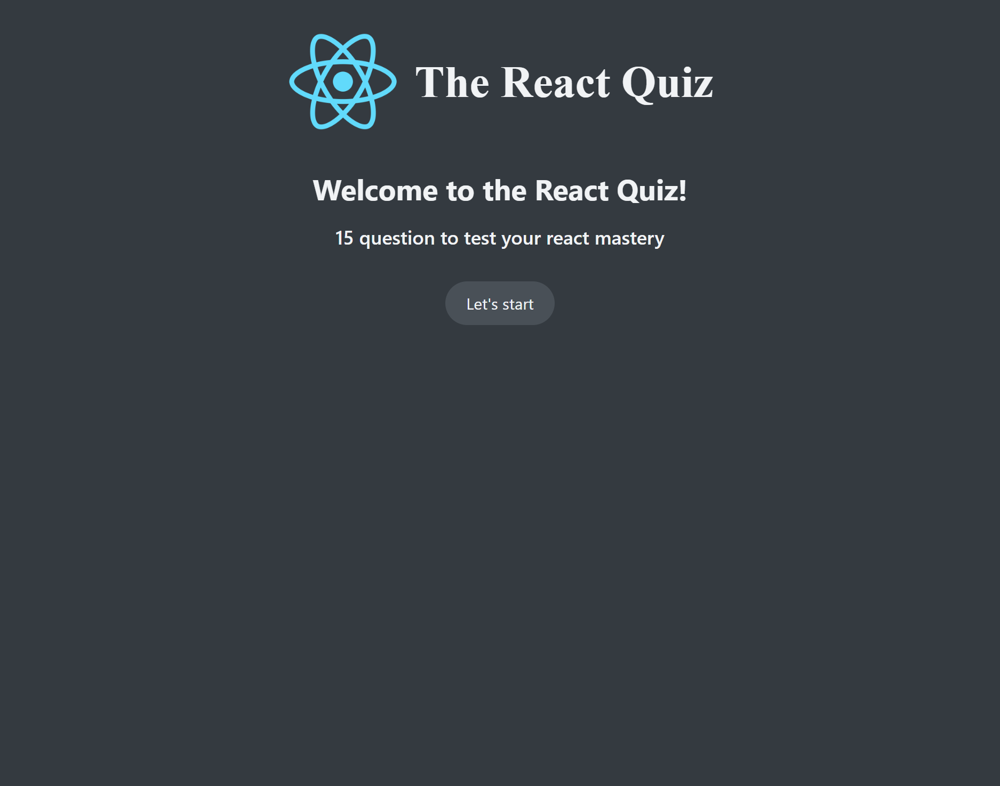
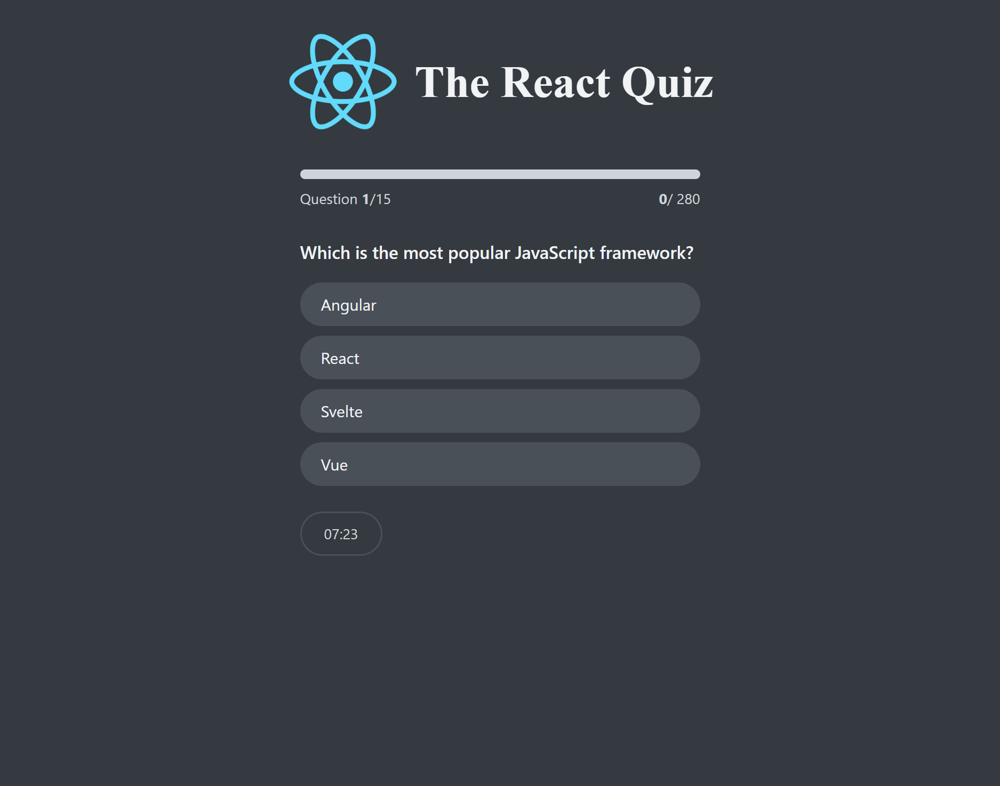
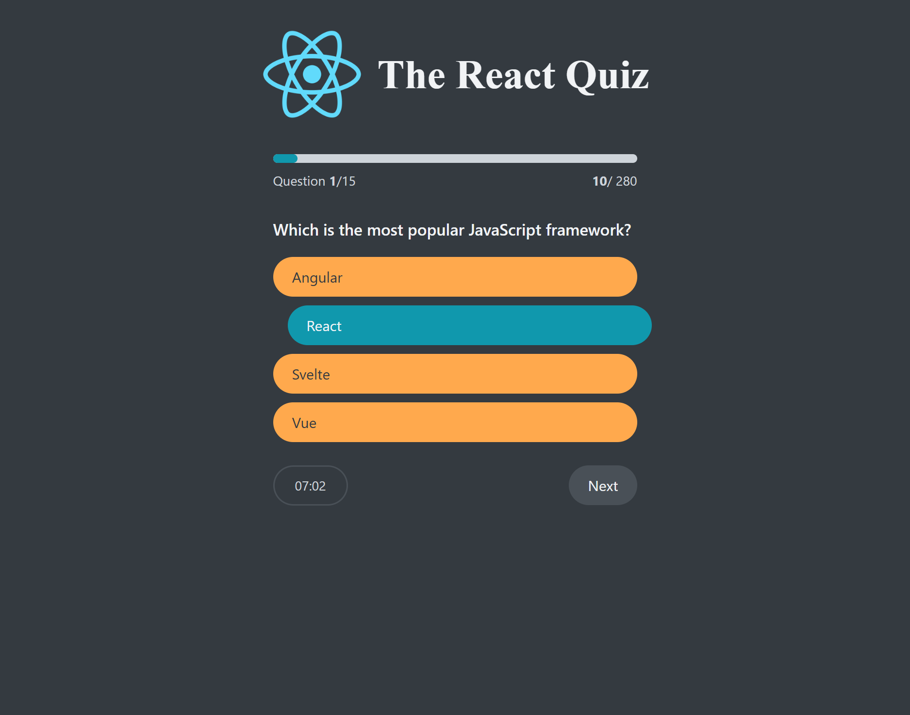
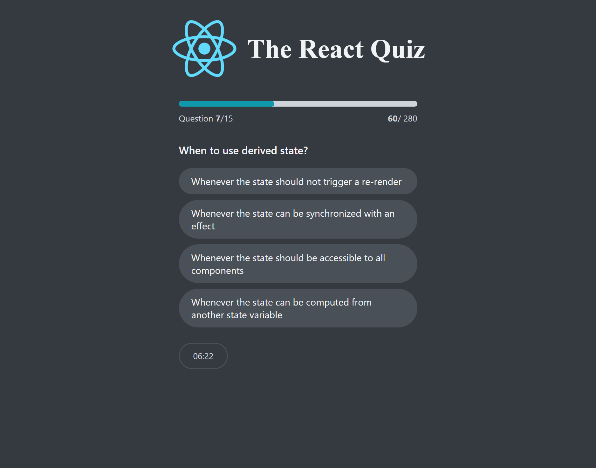
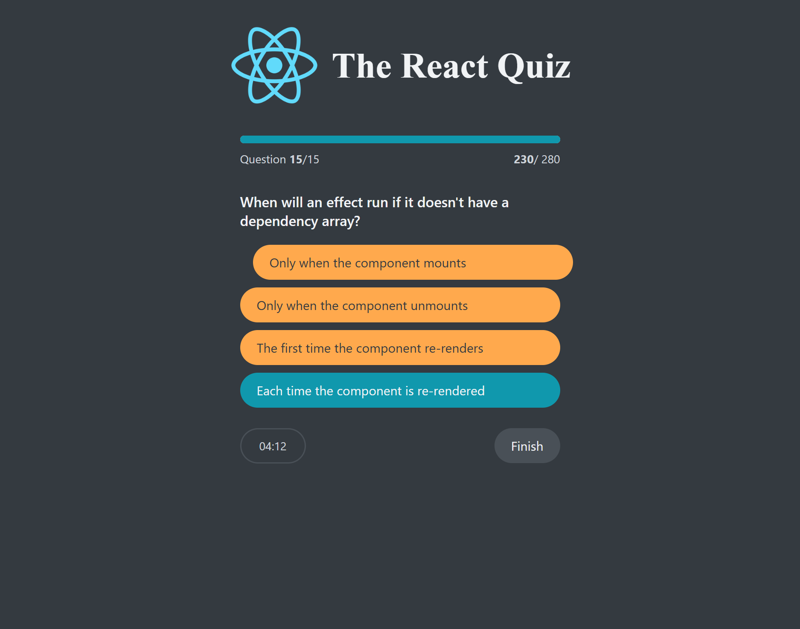
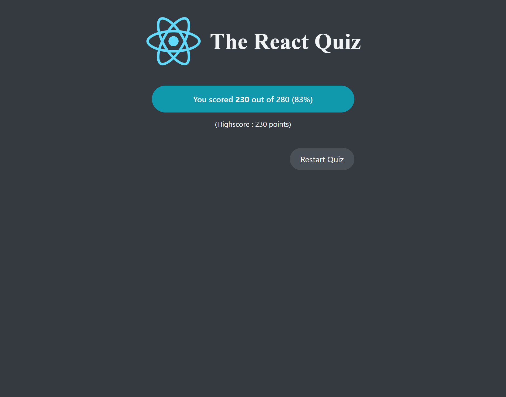

# The React Quiz

A timed, interactive quiz about React and JavaScript fundamentals. Answer 15 multiple-choice questions, track your progress and score, and see your final result when you finish or the timer runs out.

## Features

- Welcome screen showing the number of questions
- Multiple-choice questions with immediate visual feedback for correct and incorrect answers
- Progress bar, current question, and running score
- Countdown timer (30 seconds per question)
- Final score, percentage, high score, and option to restart

## Screenshots

### 1. Homepage

### 2. Question with answer feedback

Shows the selected answer, the correct answer, and the score update.

### 3. Quiz question

### 4. Quiz progress and timer

### 5. Final question

The last question uses a **Finish** button to submit the quiz.

### 6. Results

## Built with

- React
- Vite
- JSON Server
