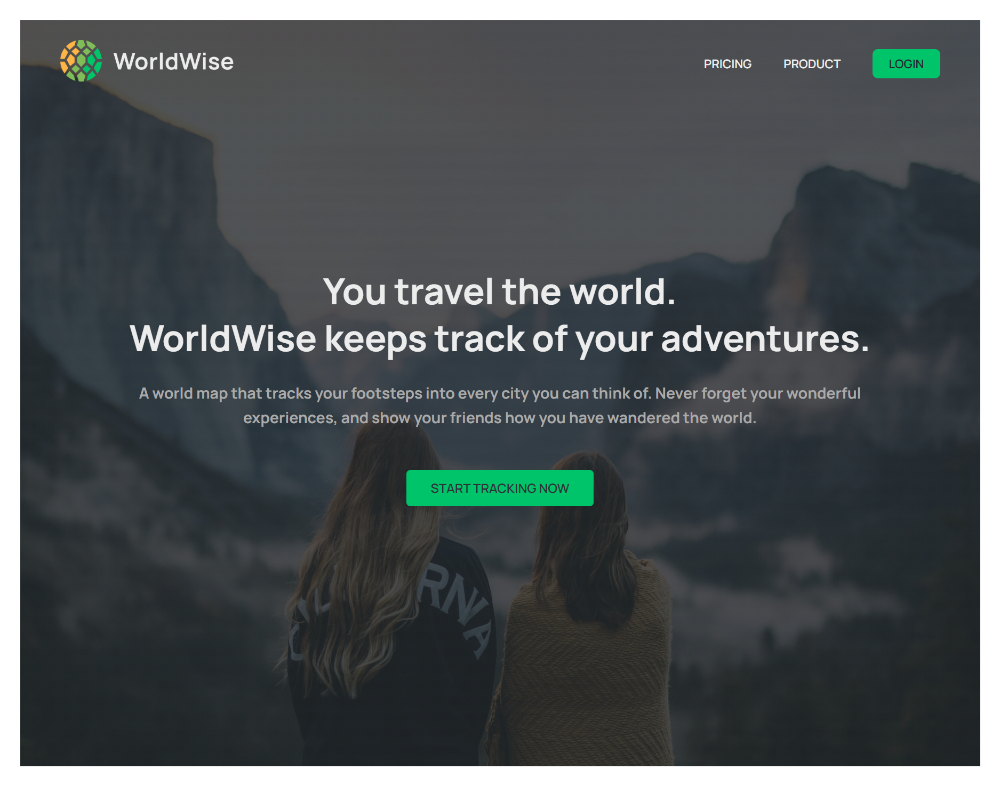
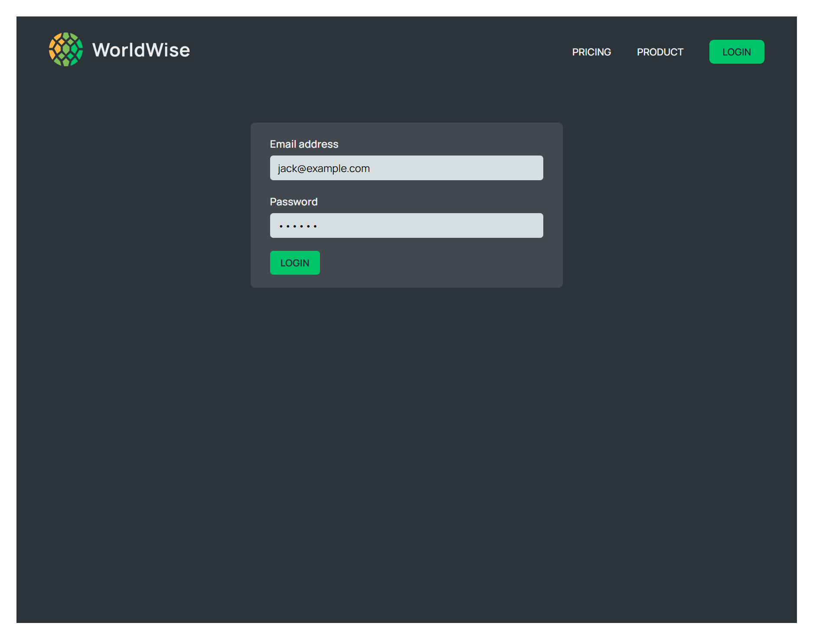
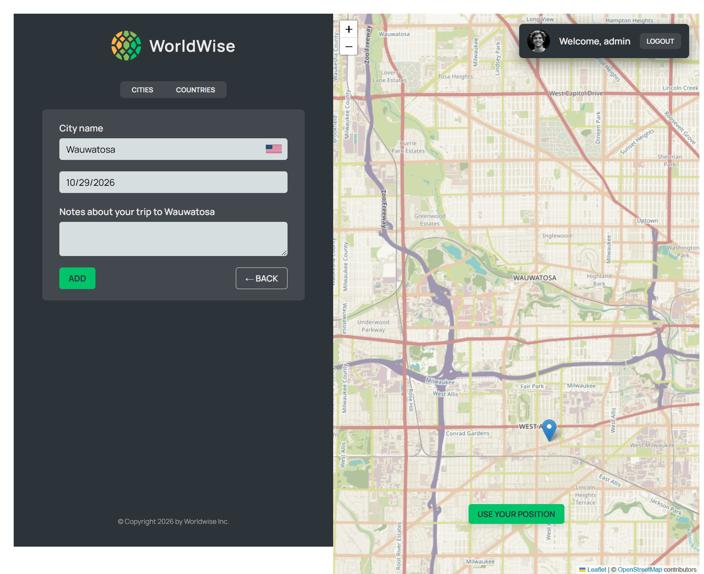
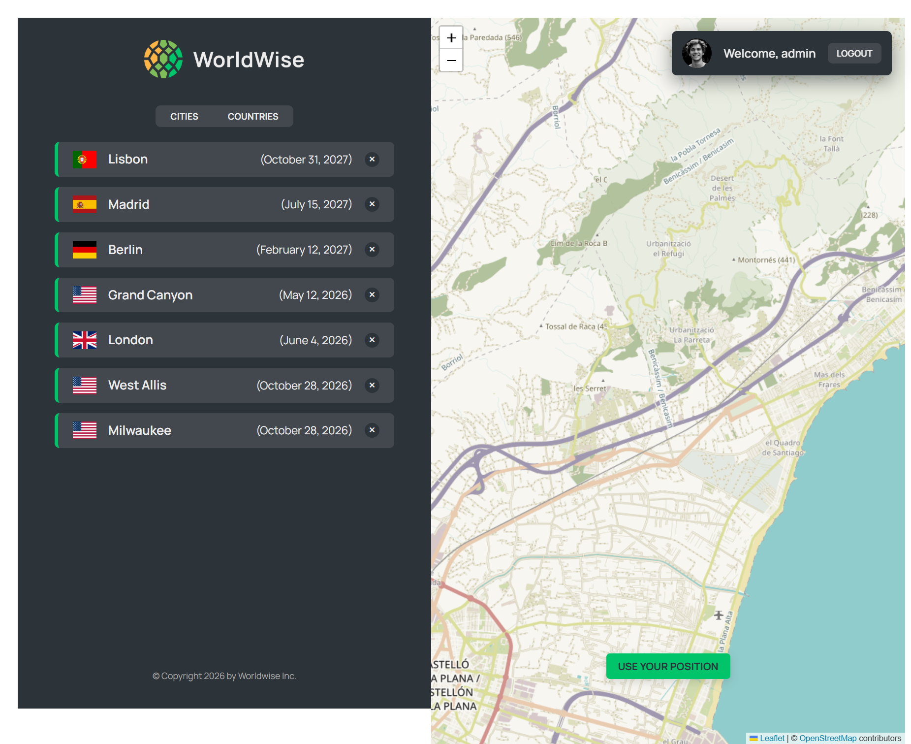
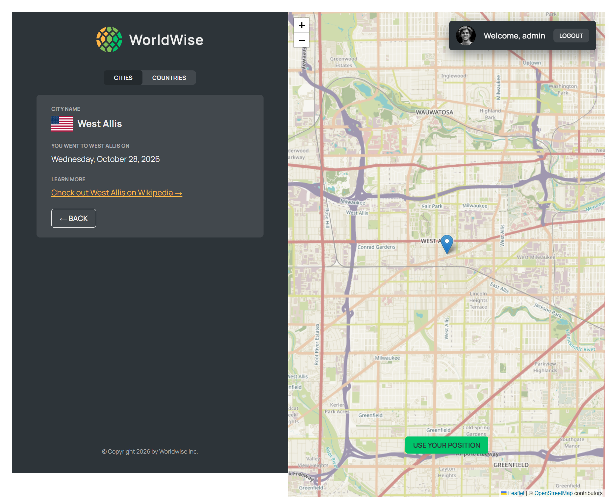
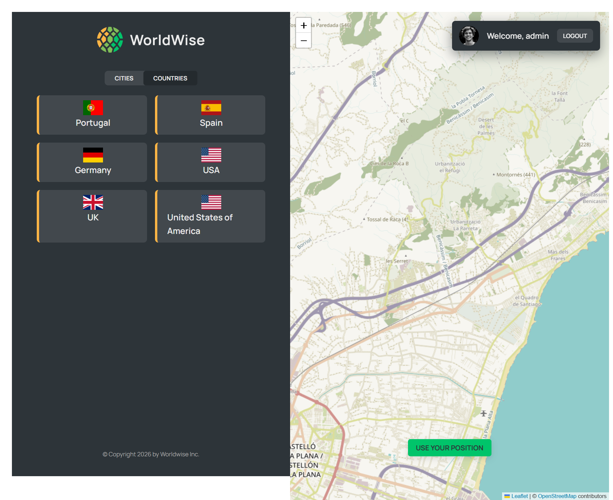
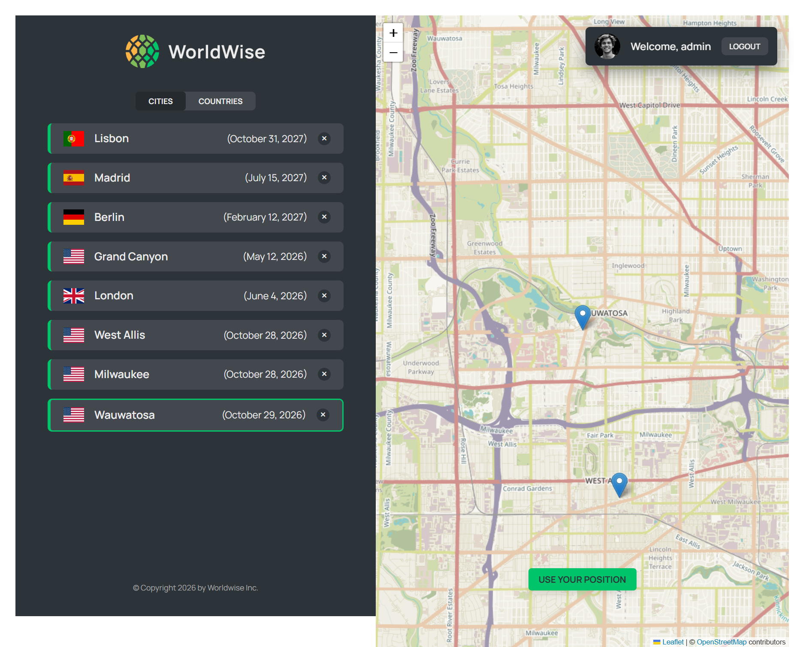

# WorldWise

WorldWise is a travel journaling app built with React that lets users record the places they have visited, view them on an interactive map, and keep notes about each trip. It is designed as a personal travel tracker inspired by modern map-based travel apps.

## Features

- Interactive world map with city markers
- User login flow with protected app routes
- Add, view, and delete visited cities
- Track city details including date and notes
- View all cities and countries in a summary list
- Responsive layout for desktop viewing

## Tech Stack

- React
- Vite
- React Router DOM
- Leaflet + React Leaflet
- JSON Server for mock backend data

## Demo Credentials

Use the following credentials to log in:

- Email: admin@example.com
- Password: password

## Getting Started

1. Install dependencies:

   ```bash
   npm install
   ```

2. Start the mock API server:

   ```bash
   npm run server
   ```

3. Start the frontend app:

   ```bash
   npm run dev
   ```

4. Open the local Vite URL shown in the terminal in your browser.

## Project Scripts

- `npm run dev` — runs the React app
- `npm run server` — starts the JSON server for city data

## Screenshots

### Homepage



### Login Page



### Add New City



### Visited Cities List



### City Details



### Countries View



### City List View


